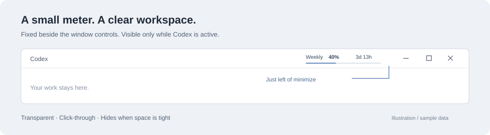
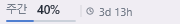

# Codexmeter

**Your Codex quota, right in the title bar.**

A small native Windows overlay that shows your **remaining usage** as thin bars. It stays beside the minimize button, follows the Codex window, and disappears when you switch apps.



*Placement illustration, not a desktop screenshot. All example percentages are synthetic.*

## What it looks like

These previews come from the actual DirectWrite renderer using test data. The application currently uses **Korean UI labels**; this guide is in English.

| Light title bar | Dark title bar | Both quota windows |
| --- | --- | --- |
|  |  |  |

- **Transparent background**, antialiased text and 2 px bars.
- **Remaining percentage**, not consumed percentage. Yellow and red indicate low remaining quota.
- Missing quota windows are omitted completely. A weekly-only account gets a smaller strip.
- Up to **280 × 24 logical pixels** for two windows, or **180 × 24** for one.
- Follows movement, resizing, maximization and display scaling.
- Hides when Codex is minimized, another app is foreground, or the title bar has too little space.
- Click-through and non-activating: the overlay does not take keyboard focus.

## Get started

Requirements: **64-bit Windows**, the Codex desktop app, and a signed-in Codex CLI that supports `app-server`. The CLI and desktop app should use the same account.

This repository contains source code. Build it using the instructions below. If a portable ZIP is provided in [Releases](https://github.com/Berry-G/Codexmeter/releases), extract it before running the executable.

1. Run `Codexmeter.exe` from the extracted folder, or `dist\Codexmeter.exe` after building.
2. Bring Codex to the foreground. Allow up to one refresh interval for the initial quota read.
3. Right-click the **Codexmeter tray icon** to manage the overlay.

No installer or administrator privileges are required. Keep the executable in a writable folder so you can edit its settings. Startup at Windows sign-in is not configured automatically.

| Tray menu | Action |
| --- | --- |
| 일시 중지 | Pause or resume the overlay |
| 새로 고침 | Request a refresh |
| 설정 파일 열기 | Open the configuration in Notepad |
| 종료 | Quit Codexmeter |

Closing Codex leaves the meter waiting in the tray. It attaches again when Codex reopens. Launching another meter instance does not create a duplicate.

## Read the meter

`단기` means **short-term**; `주간` means **weekly**. The clock shows time until the next available quota reset.

| Time remaining | Display |
| --- | --- |
| More than 24 hours | `3d 13h` |
| 24 hours or less | `20h 15m` |
| Exactly 24 hours | `24h 0m` |

Days/hours omit minutes; hours/minutes round remaining minutes up. A narrow title bar may omit the clock. If even the minimum strip width cannot fit, the whole overlay hides.

A `*` after a number and a gray bar mark a previous reading. A reset time passing does not locally force the quota to 100%; the next server response supplies the value.

## Configure

Edit **`Codexmeter.ini` beside the executable**, then restart the meter. The build creates this file from [Codexmeter.example.ini](Codexmeter.example.ini) only if it does not already exist. Rebuilding preserves your settings.

All dimensions below are logical pixels at 96 DPI and scale with the monitor.

| Setting | Default | Purpose |
| --- | --- | --- |
| `max_width` | `280` | Maximum width with two quota windows |
| `min_width` | `180` | Minimum width with two quota windows |
| `button_gap` | `8` | Gap before the minimize button |
| `titlebar_left_reserved` | `360` | Space reserved for title-bar navigation |
| `custom_button_width` | `46` | Fallback width of each of the three window buttons |
| `custom_titlebar_height` | `36` | Fallback title-bar height |
| `theme` | `auto` | Text palette: `auto`, `light` or `dark` |
| `refresh_seconds` | `60` | Refresh interval while Codex is active; minimum 60 seconds |
| `bucket` | `codex` | Exact quota bucket to read |
| `codex_path` | blank | Auto-discover CLI, or specify an absolute path to `codex.exe` |
| `target_exe` | blank | Auto-detect Codex, or specify its desktop executable path |

For a single quota window, the strip reduces its maximum width by 100 px and minimum width by 70 px, with a minimum of 110 px. Safety bounds also apply to configuration values.

Windows caption-button coordinates take priority. If Codex uses a custom title bar that does not expose them, the meter uses the configurable button and title-bar dimensions above. Adjust `custom_*` if an app update changes that layout.

The Store app can use the executable name `ChatGPT.exe`. Detection also checks the Codex installation path; it does not attach based on the filename or window title alone. For a nonstandard installation, set `target_exe` explicitly.

## Build from source

Install **Visual Studio / Build Tools** with **Desktop development with C++** and a Windows SDK. The build discovers the installed MSVC toolchain using `vswhere`. No Node.js, Electron or Python environment is needed.

```powershell
git clone https://github.com/Berry-G/Codexmeter.git
cd Codexmeter
.\build.ps1 -Test
.\dist\Codexmeter.exe
```

Exit a running meter from the tray before rebuilding its executable.

```powershell
.\build.ps1 -TestsOnly     # Offline tests and renderer previews
.\dist\tests.exe --native # Temporary test window: movement, resize, minimize, restore
.\dist\tests.exe --inspect # Check a running overlay
.\dist\tests.exe --live   # Opt-in real-account read; does not print quota values
```

Run these commands from the project root. `--native` temporarily changes foreground focus. Tests cover quota parsing, countdowns, placement and transparency. Physical multi-monitor movement, virtual desktops and exclusive fullscreen games still need verification on the target machine.

## Privacy and resource use

The meter starts a hidden Codex App Server for `initialize` and `account/rateLimits/read`, then shuts down that child process. It uses the CLI's existing authentication; the meter does not directly open authentication files or save server responses. It does not generate conversations or run a model. The CLI may contact OpenAI to obtain account limits.

New reads occur only while Codex is active; an in-flight read may finish after you switch away. Requests have a 20-second deadline, and failures back off up to five minutes. Window tracking uses Win32 events with a one-second fallback check. Rendering happens only when the displayed state changes.

The overlay uses native Windows libraries and software rendering. The temporary App Server has its own CPU and memory cost, so the overlay process alone is not the full resource footprint.

Personal configuration, build outputs, logs and local agent memories are excluded from Git. Documentation images contain fixture data only. The optional PowerShell 7 diagnostic script `tools/probe.ps1` hides quota values by default; `-ShowValues` explicitly prints them. Do not attach that output to public issues without reviewing it.

## Troubleshooting

| Symptom | Try this |
| --- | --- |
| No overlay | Activate Codex, unpause the tray menu and widen the window. Ensure there is room left of the minimize button. |
| Quota never loads | Check the CLI login, then set `codex_path` if auto-discovery fails. Use the tray tooltip for the error state. |
| Wrong account's quota | Sign the CLI into the same account as the desktop app. |
| Text is hard to see | Set `theme=light` or `theme=dark`, then restart. |
| Strip overlaps the window buttons | Adjust `custom_button_width`, `custom_titlebar_height` and `button_gap`. |
| Custom installation is not detected | Set `target_exe` to the exact desktop executable path. |
| Build cannot replace the executable | Quit the running meter and build again. |

## Prepare a public package

```powershell
.\tools\package.ps1
```

This creates `dist\Codexmeter-source.zip` from an explicit public-file list. With `-Portable`, it also packages the built executable with a **fresh default configuration**, README, images and dependency notices. It never packages your local INI, logs or agent memories. Build the executable first when making a portable package.

## Dependencies and project status

The bundled [nlohmann/json](https://github.com/nlohmann/json) header is version 3.11.3; its MIT license is in [vendor/LICENSE.json](vendor/LICENSE.json). DirectWrite, Direct2D and Win32 are Windows system components.

Codexmeter is licensed under the [MIT License](LICENSE). Copyright (c) 2026 Berry-G. Bundled third-party code retains its own copyright and license notices.

Codexmeter is an independent project and is not affiliated with OpenAI.
